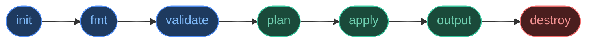
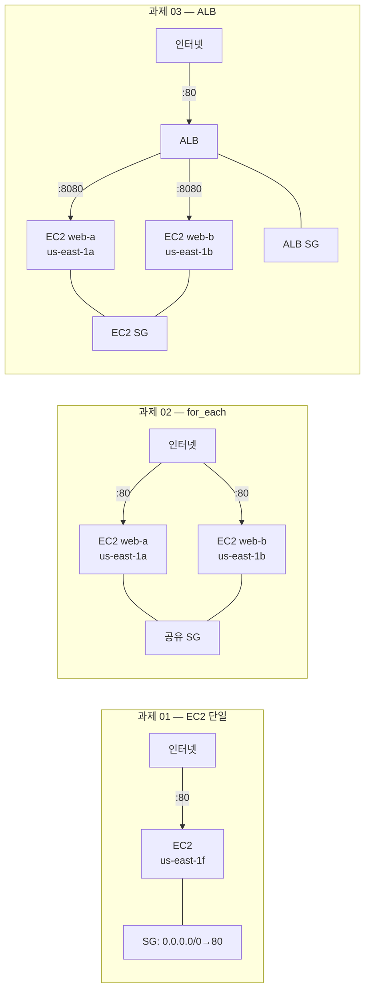
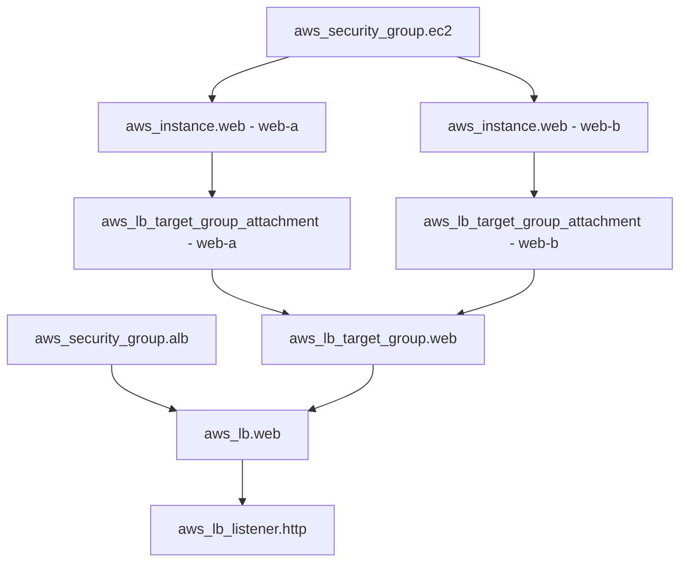
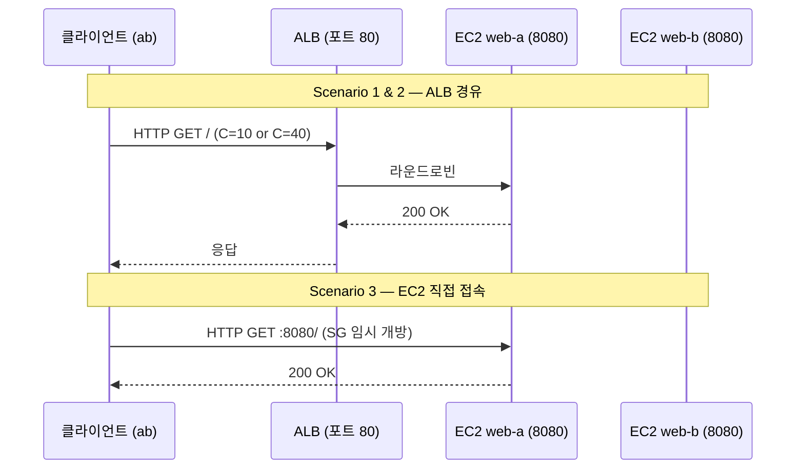
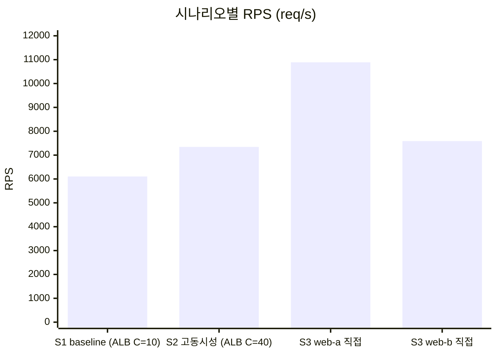
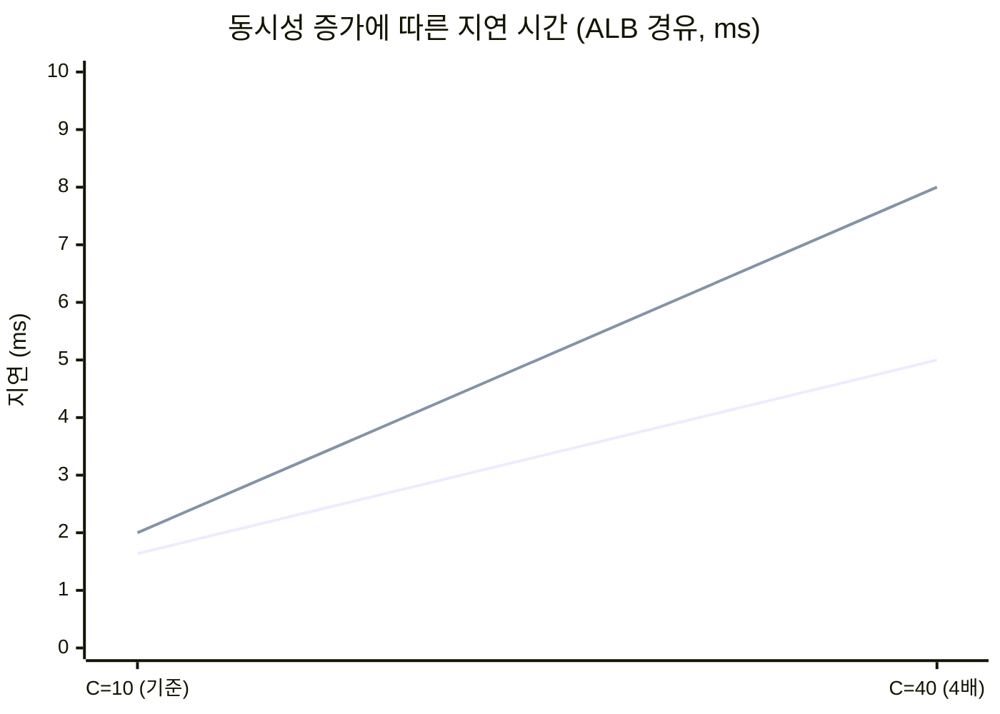

# Week 8 Lab Report: Terraform EC2 + ALB Benchmark on AWS

## 1. 실습 개요

| 항목 | 내용 |
|---|---|
| 실습 제목 | EC2 + ALB Benchmark on AWS |
| 실습 환경 | AWS Academy Learner Lab / us-east-1 / AWS CloudShell |
| 사용 도구 | Terraform v1.15.1, ApacheBench (ab v2.3), AWS CLI |
| 레포지토리 | https://github.com/mobile-os-dku-cis-mse/03-terraform-ec2-alb-hahyunnii |

### 실습 목표

3단계로 구성된 Terraform 실습을 통해 AWS 인프라를 코드로 선언·배포하고, ApacheBench로 실제 성능을 측정·해석한다. 단순히 서비스가 응답하는지 확인하는 수준을 넘어, 동시 접속자 수 증가에 따라 처리량과 지연 시간이 어떻게 변화하는지를 수치로 측정하고 해석하는 것이 목표이다.

---

## 2. Why Terraform?

### 수동 CLI의 문제점

| 항목 | 수동 AWS CLI | Terraform |
|---|---|---|
| 재현성 | 재입력 시 오류 발생 가능 | 동일 config → 동일 인프라 보장 |
| 버전 관리 | 셸 히스토리만 남음 | Git 커밋으로 변경 이력 추적 |
| 피어 리뷰 | 불가능 | Pull Request + plan 출력으로 검토 |
| 의존성 순서 | 수동으로 파악 필요 | Terraform이 그래프 자동 계산 |
| 정리 | 리소스별 수동 삭제 | `terraform destroy` 한 번으로 완전 삭제 |
| 드리프트 감지 | 없음 | 매 plan마다 실제 상태와 비교 |

### 선언형 vs 명령형

```
명령형 (AWS CLI): "이 순서대로 이 작업을 하라."
선언형 (Terraform): "이런 상태가 존재해야 한다."
```

Terraform은 desired state를 선언하면, 현재 상태와 비교하여 차이만 실행한다. `apply`를 두 번 실행해도 동일한 결과가 나오는 이유(멱등성)이다.

### Terraform 워크플로우



| 명령어 | 역할 |
|---|---|
| `init` | AWS Provider 플러그인 다운로드 |
| `fmt` | HCL 표준 형식 자동 정렬 |
| `validate` | 문법·참조 오류 검사 (AWS 연결 없음) |
| `plan -out plan.out` | 변경 예정 내용 미리 확인 후 저장 |
| `apply plan.out` | 저장된 플랜 그대로 배포 |
| `output` | 배포 결과값 출력 |
| `destroy` | 모든 리소스 역의존 순서로 삭제 |

---

## 3. 인프라 아키텍처 비교



| 항목 | 과제 01 | 과제 02 | 과제 03 |
|---|---|---|---|
| 리소스 수 | 2개 | 3개 | 9개 |
| EC2 수 | 1개 | 2개 | 2개 |
| 핵심 기술 | data source, templatefile | for_each, zipmap | ALB, TG, Listener |
| 트래픽 경로 | 클라이언트 → EC2:80 | 클라이언트 → EC2:80 (×2) | 클라이언트 → ALB:80 → EC2:8080 |
| 보안 정책 | 단일 SG | 공유 SG | SG 분리 (ALB / EC2) |
| 부하 분산 | ❌ | ❌ | ✅ ALB 자동 분산 |

---

## 4. 과제 01 — EC2 단일 웹서버

### 개요

기본 VPC에서 서브넷을 선택하고 EC2 인스턴스 1개에 Nginx를 배포한다.

**트래픽 경로**: `클라이언트 → EC2 포트 80`

### 수행 단계

**1단계 — data source로 기존 AWS 리소스 읽기**

Terraform의 `data` 블록으로 기존 VPC, 서브넷, 최신 AMI를 직접 읽어온다. AMI ID를 하드코딩하지 않고 SSM Parameter Store에서 자동으로 읽어 항상 최신 Amazon Linux 2023을 사용한다.

```hcl
data "aws_vpc" "default" { default = true }

data "aws_ssm_parameter" "al2023_ami" {
  name = "/aws/service/ami-amazon-linux-latest/al2023-ami-kernel-default-x86_64"
}
```

**2단계 — locals로 서브넷 결정론적 선택**

`sort()`로 서브넷 ID 목록을 정렬하여 항상 동일한 서브넷이 선택되도록 구성한다. 이것이 Terraform의 재현성을 보장하는 방식이다.

```hcl
locals {
  selected_subnet_id = sort(data.aws_subnets.default_vpc.ids)[0]
}
```

**3단계 — Security Group: 포트 80 허용**

인터넷에서 EC2로의 HTTP 접근을 허용하는 ingress 규칙을 선언한다.

```hcl
ingress {
  from_port   = 80
  to_port     = 80
  protocol    = "tcp"
  cidr_blocks = ["0.0.0.0/0"]
}
```

**4단계 — EC2 인스턴스: AMI, 서브넷, user_data 연결**

`templatefile()`로 EC2 부팅 시 실행할 쉘 스크립트에 변수를 주입한다. Nginx 설치 및 HTML 페이지 생성이 자동으로 이루어진다.

```hcl
resource "aws_instance" "web" {
  ami           = data.aws_ssm_parameter.al2023_ami.value
  instance_type = var.instance_type
  subnet_id     = local.selected_subnet_id
  user_data     = templatefile("${path.module}/user-data.sh", {
    name_prefix = var.name_prefix
  })
}
```

**5단계 — 배포 및 검증**

```bash
terraform init && terraform validate
terraform plan -out plan.out
terraform apply plan.out
curl "http://$(terraform output -raw instance_public_ip)"
```

### 배포 결과

| 항목 | 값 |
|---|---|
| EC2 Instance ID | `i-07cd32398b0e3aa26` |
| 퍼블릭 IP | `100.24.117.227` |
| Availability Zone | `us-east-1f` |
| 웹 서버 응답 | ✅ `<h1>Terraform Example 01</h1>` |

```bash
terraform destroy -auto-approve
# Destroy complete! Resources: 2 destroyed.
```

---

## 5. 과제 02 — EC2 두 개, 서로 다른 서브넷

### 개요

`for_each`를 활용하여 서로 다른 가용 영역(AZ)에 EC2 인스턴스 2개를 배포한다. 각 인스턴스는 고유한 서버 이름(`web-a`, `web-b`)으로 응답한다.

**트래픽 경로**: `클라이언트 → EC2 포트 80`

### 수행 단계

**1단계 — AZ별 서브넷 그룹화**

`for` 표현식과 `...` grouping 문법으로 AZ별 서브넷 맵을 생성한다.

```hcl
subnets_by_az = {
  for _, subnet in data.aws_subnet.default_vpc :
  subnet.availability_zone => subnet.id...
}
```

결과 예시: `{ "us-east-1a" = ["subnet-aaa"], "us-east-1b" = ["subnet-bbb"] }`

**2단계 — 2개 AZ 선택 및 서브넷 매핑**

`slice()`와 `sort()`로 첫 두 AZ를 선택하고, `zipmap()`으로 인스턴스 이름과 서브넷을 매핑한다.

```hcl
selected_azs        = slice(sort(keys(local.subnets_by_az)), 0, 2)
selected_subnet_ids = [for az in local.selected_azs : sort(local.subnets_by_az[az])[0]]
instance_subnet_map = zipmap(["web-a", "web-b"], local.selected_subnet_ids)
```

결과: `{ "web-a" = "subnet-aaa", "web-b" = "subnet-bbb" }`

**3단계 — for_each로 EC2 2개 동시 생성**

리소스 블록 하나로 여러 인스턴스를 생성한다. `each.key`는 인스턴스 이름, `each.value`는 서브넷 ID이다.

```hcl
resource "aws_instance" "web" {
  for_each      = local.instance_subnet_map
  ami           = data.aws_ssm_parameter.al2023_ami.value
  instance_type = var.instance_type
  subnet_id     = each.value
  user_data     = templatefile("${path.module}/user-data.sh", {
    name_prefix = var.name_prefix
    server_name = each.key
  })
}
```

**4단계 — 배포 및 state 확인**

`for_each`로 생성된 리소스는 state에 키가 붙어 독립적으로 관리된다.

```bash
terraform state list
# aws_instance.web["web-a"]  ← 키가 붙어 개별 수정/삭제 가능
# aws_instance.web["web-b"]
```

### 배포 결과

| 항목 | web-a | web-b |
|---|---|---|
| Instance ID | `i-00ecae2a36197d93f` | `i-073c7b6a7665ea08c` |
| 퍼블릭 IP | `98.92.238.10` | `3.87.223.203` |
| Availability Zone | `us-east-1a` | `us-east-1b` |
| 웹 서버 응답 | ✅ Server Name: web-a | ✅ Server Name: web-b |

`web-a`와 `web-b`가 각각 다른 서버 이름으로 응답하여 `for_each`와 `templatefile()`의 `server_name = each.key` 주입이 정상 동작함을 확인했다.

```bash
terraform destroy -auto-approve
# Destroy complete! Resources: 3 destroyed.
```

---

## 6. 과제 03 — ALB + EC2 두 개

### 개요

Application Load Balancer(ALB)를 EC2 2개 앞에 배치하여 트래픽을 분산하고, ApacheBench로 성능을 측정한다.

**트래픽 경로**: `클라이언트 → ALB 포트 80 → EC2 포트 8080`

### 수행 단계

**1단계 — ALB/TG 이름 생성 (32자 제한 대응)**

AWS ALB와 Target Group 이름은 32자 제한이 있다. `substr()`로 자동 절단한다.

```hcl
locals {
  alb_name          = substr("${var.name_prefix}-alb", 0, 32)
  target_group_name = substr("${var.name_prefix}-tg", 0, 32)
}
```

**2단계 — Security Group 분리: ALB SG와 EC2 SG 독립 구성**

ALB는 인터넷에서 포트 80을 허용하고, EC2는 ALB SG에서 오는 트래픽만 포트 8080으로 허용한다. `cidr_blocks` 대신 `security_groups`를 사용하는 SG-to-SG 규칙이다.

```hcl
# ALB SG: 인터넷 → 포트 80
resource "aws_security_group" "alb" {
  ingress {
    from_port   = 80
    to_port     = 80
    protocol    = "tcp"
    cidr_blocks = ["0.0.0.0/0"]
  }
}

# EC2 SG: ALB SG에서만 → 포트 8080
resource "aws_security_group" "ec2" {
  ingress {
    from_port       = var.app_port
    to_port         = var.app_port
    protocol        = "tcp"
    security_groups = [aws_security_group.alb.id]
  }
}
```

이 구성으로 EC2에는 ALB를 통해서만 접근 가능하며, 인터넷에서의 직접 접속은 차단된다.

**3단계 — Target Group + Health Check 구성**

ALB가 EC2의 상태를 주기적으로 확인하는 헬스체크를 설정한다. 15초 간격으로 포트 8080의 `/` 경로에 요청을 보내 HTTP 200 응답이 오는지 확인한다.

```hcl
resource "aws_lb_target_group" "web" {
  name        = local.target_group_name
  port        = var.app_port
  protocol    = "HTTP"
  vpc_id      = data.aws_vpc.default.id
  target_type = "instance"

  health_check {
    enabled             = true
    healthy_threshold   = 2
    unhealthy_threshold = 2
    interval            = 15
    timeout             = 5
    protocol            = "HTTP"
    path                = "/"
    matcher             = "200"
    port                = "traffic-port"
  }
}
```

**4단계 — ALB 생성 및 Listener 연결**

ALB는 최소 2개의 서로 다른 AZ 서브넷이 필요하다. Listener는 포트 80으로 들어오는 트래픽을 Target Group으로 전달한다.

```hcl
resource "aws_lb" "web" {
  name               = local.alb_name
  internal           = false
  load_balancer_type = "application"
  security_groups    = [aws_security_group.alb.id]
  subnets            = local.selected_subnet_ids
}

resource "aws_lb_listener" "http" {
  load_balancer_arn = aws_lb.web.arn
  port              = 80
  protocol          = "HTTP"

  default_action {
    type             = "forward"
    target_group_arn = aws_lb_target_group.web.arn
  }
}
```

**5단계 — 리소스 의존 관계**



### 배포 결과

```
Apply complete! Resources: 9 added, 0 changed, 0 destroyed.

alb_dns_name = "ccaws-tf03-alb-2085592401.us-east-1.elb.amazonaws.com"
instance_ids = {
  "web-a" = "i-0f978a94fc458de8a"
  "web-b" = "i-019e7009501531238"
}
instance_public_ips = {
  "web-a" = "44.204.114.109"
  "web-b" = "13.220.158.32"
}
selected_availability_zones = ["us-east-1a", "us-east-1b"]
target_group_arn = "arn:aws:...:targetgroup/ccaws-tf03-tg/4d71269fa5692263"
```

---

## 7. 벤치마크 사전 준비

### 타겟 헬스 확인

```bash
aws elbv2 describe-target-health \
  --target-group-arn "$(terraform output -raw target_group_arn)" \
  --query 'TargetHealthDescriptions[*].{ID:Target.Id,State:TargetHealth.State}' \
  --output table
```

```
------------------------------------
|       DescribeTargetHealth       |
+----------------------+-----------+
|          ID          |   State   |
+----------------------+-----------+
|  i-0f978a94fc458de8a |  healthy  |
|  i-019e7009501531238 |  healthy  |
+----------------------+-----------+
```

ALB가 비정상 타겟으로 트래픽을 라우팅하면 모든 지연 수치가 왜곡되므로, 벤치마크 전 반드시 확인해야 한다.

### 웜업 요청

```bash
ALB_DNS="ccaws-tf03-alb-2085592401.us-east-1.elb.amazonaws.com"
for i in 1 2 3 4 5; do curl -s "http://${ALB_DNS}" | head -n 1; done
```

```
<h1>Terraform Example 03</h1>  (5회 반복)
```

콜드 스타트 지연을 제거하여 안정적인 기준선을 측정하기 위한 필수 단계이다.

### Raw ab 확인

```bash
ab -n 100 -c 10 "http://${ALB_DNS}/"
```

실제 ab 출력 (baseline):
```
Complete requests:      100
Failed requests:        0
Requests per second:    6105.01 [#/sec] (mean)
Time per request:       1.638 [ms] (mean)

Percentage of the requests served within a certain time (ms)
  50%      1
  95%      2
 100%      3 (longest request)
```

| 필드 | 값 | 해석 |
|---|---|---|
| Complete requests | 100 | 요청 누락 없음 ✅ |
| Failed requests | 0 | 모든 요청 HTTP 2xx 응답 ✅ |
| Requests per second | 6,105 | 처리량 — 반드시 실패율과 함께 해석 |
| Time per request | 1.638 ms | 평균값은 이상값을 숨길 수 있음 |
| P95 | 2 ms | 5%의 사용자가 2ms 이상 대기 |
| P100 | 3 ms | 최악의 요청 |

---

## 8. 벤치마크 시나리오

### 트래픽 흐름



### Scenario 1 — Baseline ALB

낮은 동시성에서 기준 성능을 수립한다. 이 값이 이후 모든 비교의 기준점이 된다.

```bash
RESET_SUMMARY=true \
SCENARIO_NAME=baseline-alb \
REQUESTS=100 CONCURRENCY=10 \
TARGET_URL="http://${ALB_DNS}/" TARGET_LABEL=alb \
bash scripts/run-http-benchmark.sh
```

| 항목 | 값 |
|---|---|
| Complete / Failed | 100 / 0 |
| RPS | 6,105.01 |
| 평균 지연 | 1.638 ms |
| P95 지연 | 2 ms |
| P100 지연 | 3 ms |

### Scenario 2 — Higher Concurrency ALB

동시성을 10 → 40으로 높여, 처리량이 증가·유지·감소하는지 관찰한다.

```bash
SCENARIO_NAME=higher-concurrency-alb \
REQUESTS=400 CONCURRENCY=40 \
TARGET_URL="http://${ALB_DNS}/" TARGET_LABEL=alb \
bash scripts/run-http-benchmark.sh
```

| 항목 | 값 |
|---|---|
| Complete / Failed | 400 / 0 |
| RPS | 7,345.92 |
| 평균 지연 | 5.0 ms |
| P95 지연 | 8 ms |
| P100 지연 | 10 ms |

### Scenario 3 — Direct EC2 Comparison

ALB를 우회하여 단일 EC2에 직접 접속해 ALB 오버헤드를 분리 측정한다. EC2 SG에 CloudShell IP(`44.211.243.55/32`) 임시 허용 후 측정, 완료 후 즉시 원복했다.

```bash
# web-a
SCENARIO_NAME=direct-compare \
REQUESTS=100 CONCURRENCY=10 \
TARGET_URL="http://44.204.114.109:8080/" TARGET_LABEL=direct-web-a \
bash scripts/run-http-benchmark.sh

# web-b
SCENARIO_NAME=direct-compare-web-b \
REQUESTS=100 CONCURRENCY=10 \
TARGET_URL="http://13.220.158.32:8080/" TARGET_LABEL=direct-web-b \
bash scripts/run-http-benchmark.sh
```

| 항목 | web-a (us-east-1a) | web-b (us-east-1b) |
|---|---|---|
| Complete / Failed | 100 / 0 | 100 / 0 |
| RPS | 10,890.87 | 7,588.98 |
| 평균 지연 | 1.0 ms | 1.0 ms |
| P95 지연 | 1 ms | 1 ms |
| P100 지연 | 1 ms | 1 ms |

---

## 9. 결과 분석

### summary.csv

```
scenario,target,tool,requests,concurrency,success,failed,avg_time_sec,p95_time_sec,requests_per_sec
baseline-alb,alb,ab,100,10,100,0,0.001000,0.002000,6105.01
higher-concurrency-alb,alb,ab,400,40,400,0,0.005000,0.008000,7345.92
direct-compare,direct-web-a,ab,100,10,100,0,0.001000,0.001000,10890.87
direct-compare-web-b,direct-web-b,ab,100,10,100,0,0.001000,0.001000,7588.98
```

### 시나리오별 RPS 비교



### 동시성 증가에 따른 지연 시간 변화



### 전체 시나리오 결과

| 시나리오 | 대상 | C | 요청 | 실패 | RPS | 평균 지연 | P95 | P100 |
|---|---|---|---|---|---|---|---|---|
| S1 baseline | ALB | 10 | 100 | 0 | **6,105** | 1.638 ms | 2 ms | 3 ms |
| S2 high concurrency | ALB | 40 | 400 | 0 | **7,345** | 5.0 ms | 8 ms | 10 ms |
| S3 direct web-a | EC2 직접 | 10 | 100 | 0 | **10,890** | 1.0 ms | 1 ms | 1 ms |
| S3 direct web-b | EC2 직접 | 10 | 100 | 0 | **7,588** | 1.0 ms | 1 ms | 1 ms |

---

### ① 처리량 추세

동시성이 C=10 → C=40으로 4배 증가할 때 RPS는 6,105 → 7,345로 약 **1.20배** 증가에 그쳤다. 동시성 증가에 비례하지 않은 것은 EC2 백엔드가 처리 한계에 근접하고 있음을 나타낸다. 더 높은 동시성이 항상 더 높은 처리량을 의미하지는 않으며, 모든 시스템에는 포화 지점이 있다.

### ② 지연 시간 변화

P95 지연이 2ms → 8ms로 **300% 증가**했다. 처리량은 1.2배 증가에 그친 반면 꼬리 지연은 4배 증가했다. 이는 동시 요청이 큐에 쌓이면서 일부 요청이 더 오래 기다리게 되는 현상이다. 평균 지연은 이상값을 숨길 수 있으므로 P95를 함께 보고해야 한다.

### ③ 실패 요청

S1, S2 모두 실패 요청이 **0건**이었다. 현재 동시성 수준(C=40)이 인프라의 안정적 운영 구간 내에 있음을 나타낸다.

### ④ 타겟 헬스

벤치마크 시작 전 두 타겟 모두 `healthy` 상태를 확인했다. 비정상 타겟에 벤치마크를 실행하면 한 인스턴스에 모든 부하가 집중되어 실제 기준선이 왜곡된다.

### ⑤ ALB vs 직접 접속

EC2 직접 접속(web-a: 10,890 RPS, 1.0ms)이 ALB 경유(6,105 RPS, 1.638ms)보다 약 **1.78배** 빠르게 측정됐다. ALB 경유 시 라우팅·헬스체크·로깅 오버헤드가 추가되기 때문이다.

그럼에도 ALB가 필요한 이유:

| 기능 | ALB 경유 | EC2 직접 접속 |
|---|---|---|
| 헬스 기반 라우팅 | 비정상 타겟 자동 제외 | 장애 인스턴스에도 요청 전달 |
| 부하 분산 | 두 EC2에 트래픽 분산 | 단일 인스턴스에 집중 |
| TLS 종료 | ALB에서 처리 (EC2 CPU 절감) | EC2에서 직접 처리 |
| 경로 기반 라우팅 | `/api/*`, `/web/*` 분리 가능 | 불가 |

ALB 오버헤드(약 +0.6ms)는 위 기능들에 대한 의도된 비용이다.

web-a(10,890)가 web-b(7,588)보다 빠른 이유는 CloudShell이 us-east-1a에 물리적으로 더 가깝기 때문이다.

### ⑥ 가용성 vs 용량

EC2 1개 장애 시:
- **가용성**: ALB가 healthy 인스턴스로 계속 라우팅 → 서비스 **유지**
- **용량**: 처리 용량 50% 감소 → 동일 부하에서 RPS 감소, 지연 증가

가용성과 용량은 다른 개념이다. ALB 헬스 기반 라우팅은 가용성을 보장하지만, 용량 감소는 오토스케일링으로 해결해야 한다.

### ⑦ CloudWatch 연계 메트릭

| CloudWatch 메트릭 | 대응하는 벤치마크 측정값 | 의미 |
|---|---|---|
| `ALB: TargetResponseTime` | avg_time_ms | ALB가 백엔드로부터 응답받는 시간 |
| `ALB: HTTPCode_ELB_5XX_Count` | failed_req | ALB 자체 오류 |
| `EC2: CPUUtilization` | — | C=40 실행 중 80% 이상이면 EC2가 병목 |
| `ALB: RequestCount` | total_req | 총 요청 수 |

### ⑧ 오토스케일링 트리거

t3.micro에서 정적 HTML을 서비스하는 이 환경에서는 `CPUUtilization`이 가장 단순한 트리거 후보이다. 프로덕션에서는 `TargetResponseTime`이 선호된다 — CPU 한계 도달 전에 사용자 경험 저하가 먼저 나타나기 때문이다.

---

## 10. 3가지 해석 규칙

**Rule 1 — 무엇을 측정했는지 명시**

"CloudShell에서 ab로 100개 요청을 동시성 10으로 ALB DNS에 전송했다."

**Rule 2 — 시나리오 간 변경된 단 하나의 변수 명시**

"Scenario 2에서는 동시성만 10 → 40으로 변경했다. 나머지는 동일했다."

**Rule 3 — 결과는 증거이지 증명이 아님**

- ❌ "백엔드는 최대 부하 상태이다."
- ✅ "결과는 백엔드가 처리 한계에 근접하고 있음을 시사한다. 다음 단계: CloudWatch CPUUtilization 확인."

---

## 11. 리소스 삭제

```bash
terraform destroy -auto-approve
```

실제 출력:
```
aws_lb_listener.http: Destruction complete after 0s
aws_lb.web: Destruction complete after 26s
aws_instance.web["web-a"]: Destruction complete after 20s
aws_instance.web["web-b"]: Destruction complete after 30s
aws_security_group.ec2: Destruction complete after 1s
aws_security_group.alb: Destruction complete after 0s

Destroy complete! Resources: 9 destroyed.
```

---

## 12. 종합 정리

### 3개 과제 요약

| 과제 | 리소스 수 | 핵심 개념 | 결과 |
|---|---|---|---|
| 01 — EC2 단일 | 2개 | data source, templatefile, SG | 웹 서버 응답 확인 ✅ |
| 02 — EC2 멀티 | 3개 | for_each, zipmap, AZ 분산 | web-a/b 각각 응답, state list 확인 ✅ |
| 03 — ALB | 9개 | ALB, TG, Listener, SG 분리 | 벤치마크 4개 시나리오 완료 ✅ |

### 주요 학습 내용

Terraform의 `init → fmt → validate → plan → apply → destroy` 워크플로우를 통해 수동 CLI 대비 재현성과 안정성을 확보했다. `plan` 단계에서 실제 변경 전 모든 리소스 변화를 미리 확인할 수 있다는 점이 가장 큰 차별점이다.

동시성 증가에 따른 RPS와 지연의 비선형적 변화를 직접 측정했고, ALB 경유 오버헤드(+0.6ms)를 수치로 확인했다. Security Group 분리 설계가 실제로 EC2 직접 접속을 차단하는 것을 실험으로 증명했다.

벤치마크 결과는 증거이지 증명이 아니며, 더 높은 동시성(C=100 이상)에서의 포화 지점 탐색과 CloudWatch 메트릭과의 교차 검증은 추가 실험이 필요하다.
